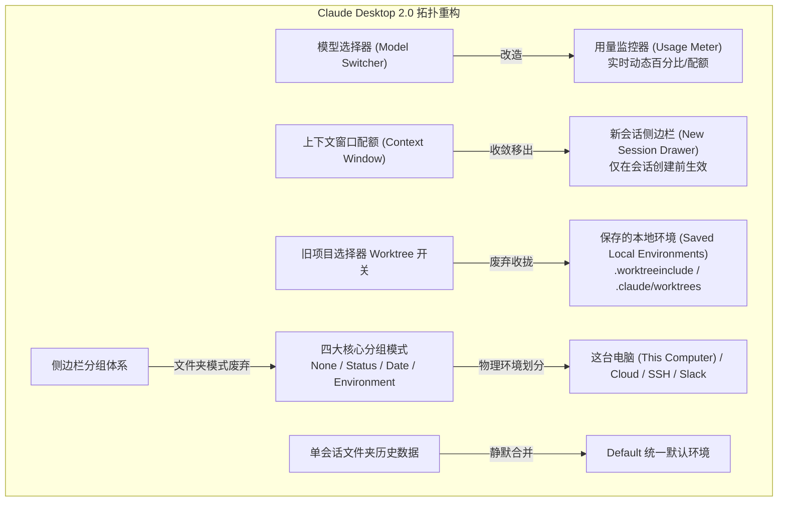
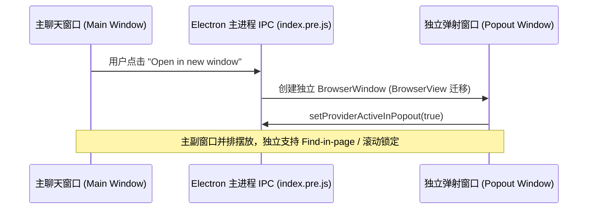
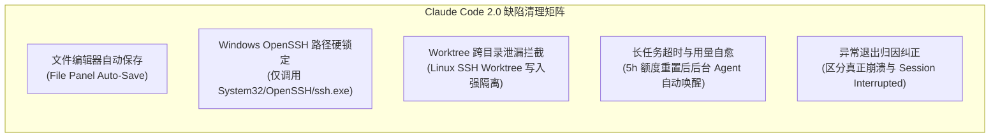

# 第九篇：Claude Desktop 2.0 (v2.37337.1) 全量版本更新深度逆向分析与架构演进报告

> **目标应用载体**：Anthropic 官方生产包 macOS `/Applications/Claude.app`  
> **二进制元数据**：`@ant/desktop v2.37337.1`（Build: `2026-10-13T22:16:06Z`，开发者签名：`Developer ID Application: Anthropic PBC (Q6L2SF6YDW)`）  
> **逆向工具栈**：**[REA (Reverse Engineer Anything) v6.5.0](https://github.com/morluto/rea)** 全流程执行 Fuse 熔丝扫描、Mach-O 代码签名提取、AST 抽象语法树解构与 Electron ASAR 运行时逆向审计。

---

## 🧭 全景导航索引
- [9.1 版本发布定位与核心工程边界廓清](#91-版本发布定位与核心工程边界廓清)
- [9.2 核心界面拓扑演进与工作流重构 (Anthony Morris 评述与社区焦点)](#92-核心界面拓扑演进与工作流重构-anthony-morris-评述与社区焦点)
  - [9.2.1 模型选择器用量指标化与上下文移入新会话抽屉](#921-模型选择器用量指标化与上下文移入新会话抽屉)
  - [9.2.2 Worktree 宿主化：收拢至“保存的本地环境”](#922-worktree-宿主化收拢至保存的本地环境)
  - [9.2.3 侧边栏四态分组与文件夹强行并入 Default 迁移逆向](#923-侧边栏四态分组与文件夹强行并入-default-迁移逆向)
  - [9.2.4 “Pin as chapter” 界面泄漏的真实面目解密](#924-pin-as-chapter-界面泄漏的真实面目解密)
- [9.3 通用桌面交互与 Electron 运行时升级](#93-通用桌面交互与-electron-运行时升级)
  - [9.3.1 多窗口弹射架构 (Open in New Window / Popout)](#931-多窗口弹射架构-open-in-new-window--popout)
  - [9.3.2 后台 Computer Use 焦点防抢占与键盘输入保护](#932-后台-computer-use-焦点防抢占与键盘输入保护)
  - [9.3.3 发送失败消息的本地持久化账本与防丢重试](#933-发送失败消息的本地持久化账本与防丢重试)
  - [9.3.4 Windows 路径空格命令行转义与 PAC 代理动态热重载](#934-windows-路径空格命令行转义与-pac-代理动态热重载)
  - [9.3.5 Windows 代码签名证书轮换及企业白名单策略应对](#935-windows-代码签名证书轮换及企业白名单策略应对)
- [9.4 Claude Code 桌面引擎与底座缺陷大清洗 (Bug Sweeps)](#94-claude-code-桌面引擎与底座缺陷大清洗-bug-sweeps)
  - [9.4.1 文件面板编辑器自动保存 (Editor Auto-Save)](#941-文件面板编辑器自动保存-editor-auto-save)
  - [9.4.2 Windows OpenSSH 路径硬锁定 (`ssh.exe`)](#942-windows-openssh-路径硬锁定-sshexe)
  - [9.4.3 十大关键并发与隔离缺陷修复深度剖析](#943-十大关键并发与隔离缺陷修复深度剖析)
- [9.5 Cowork 协同看板与离线资产化底座](#95-cowork-协同看板与离线资产化底座)
  - [9.5.1 三大核心渲染库本地随包捆绑 (Chart.js / Grid.js / Mermaid)](#951-三大核心渲染库本地随包捆绑-chartjs--gridjs--mermaid)
  - [9.5.2 本机虚拟机禁用时自动平滑切流云端](#952-本机虚拟机禁用时自动平滑切流云端)
  - [9.5.3 定时任务二次编辑与应用重载首字防丢失](#953-定时任务二次编辑与应用重载首字防丢失)
- [9.6 企业托管配置 Breaking Changes 升级指南 (IT 管理员必读)](#96-企业托管配置-breaking-changes-升级指南-it-管理员必读)
  - [9.6.1 键名废弃与新旧映射全量对照表](#961-键名废弃与新旧映射全量对照表)
  - [9.6.2 “静默降级为未托管”故障排查与 OAuth MCP 重新认证](#962-静默降级为未托管故障排查与-oauth-mcp-重新认证)

---

## 9.1 版本发布定位与核心工程边界廓清

在本次 2026-10-15 发布的 Claude 桌面端全量更新中，软件版本跃升至 **v2.37337.1**。

通过 REA 提取 `/Applications/Claude.app/Contents/Resources/app.asar/package.json` 及 Electron 熔丝与代码签名，我们首先厘清本次发布的关键环境边界：

```json
{
  "name": "@ant/desktop",
  "productName": "Claude",
  "version": "2.37337.1",
  "main": ".vite/build/index.pre.js",
  "devDependencies": {
    "@anthropic-ai/claude-agent-sdk": "0.3.295",
    "@ant/cds": "workspace:*",
    "@ant/managed-config": "*",
    "@ant/dxt-registry": "*"
  }
}
```

```
[REA Fuse Audit 证据]
- RunAsNode: disabled (48)
- EnableNodeCliInspectArguments: disabled (48)
- EnableEmbeddedAsarIntegrityValidation: enabled (49)
- OnlyLoadAppFromAsar: enabled (49)
- Hardened Runtime: true
- Code Signing Authority: Developer ID Application: Anthropic PBC (Q6L2SF6YDW)
```

> ⚠️ **关键发布范围边界（严防信息混淆）**：  
> 1. **桌面端内嵌版本**：本次桌面端安装包捆绑集成的 Claude Code CLI 运行时严格保持在 **v2.1.295**（对应 SDK `0.3.295`）；  
> 2. **独立 CLI 发布区分**：社区同日讨论的 Claude Code CLI `v2.1.299` / `v2.1.300`（包含终端 `idle compaction` 空闲压缩、`/effort` 思考算力滑块、`mod` 扩展的 `virtualText` 虚拟文本注入等）为**命令行独立工具链的单独发布**，桌面端尚未升级该底层 CLI，切勿将终端独立特性误记为桌面端更新。

---

## 9.2 核心界面拓扑演进与工作流重构 (Anthony Morris 评述与社区焦点)

Claude Code 核心工程师 **Anthony Morris** 在社区补充了解释，同时 GitHub 上针对 v2.37337.1 侧边栏的剧烈变化引发了大量关注。我们通过反编译代码还原其实际控制链路：



### 9.2.1 模型选择器用量指标化与上下文移入新会话抽屉
* **逆向实现变更**：在 `index.chunk-Bz7ICyQH.js` 与 `index.chunk-BWk6pVUt.js` 中，原先与模型下拉菜单并列的 Token Gauge 被重构为 **`UsageMeter`**，直接通过 `getContextUsageSummary` 获取账号维度的剩余额度与重置倒计时；
* **上下文窗口（Context Window）不可变约束**：
  - 过去运行时可微调上下文容量的设计被彻底废除；
  - 逆向逻辑显示：`sessionId` 一旦生成，`contextWindow` 的 Token 边界即被锁定。上下文选择器被从聊天主界面剥离，移入左侧或弹出的“新会话初始化面板（New Session Drawer）”，仅允许在会话初始化阶段预设。

### 9.2.2 Worktree 宿主化：收拢至“保存的本地环境”
* **旧模式缺陷**：旧版桌面端在顶部项目选择器上提供了一个孤立的 `Use Worktree` 复选开关，容易导致开发者在同一个 Git 根目录下无意识地反复克隆 Worktree，引发锁冲突与磁盘膨胀；
* **新架构落地**：
  - Worktree 开关不再独立暴露，而是与环境预设强绑定；
  - 在 `index.chunk-DknswonR.js` 中引入了规范化的持久结构：
    ```typescript
    var Vt = ".worktreeinclude",
        Ht = ".claude",
        Ut = `${Ht}/worktrees`,
        Wt = [".mcp.json", "CLAUDE.md", "CLAUDE.local.md"];
    ```
  - 开发者必须在“保存的本地环境（Saved Local Environments）”中统一定义 Worktree 衍生策略，由环境配置自动挂载专属的 `.claude/worktrees` 目录，并在创建时自动将受保护配置文件（`.mcp.json`, `CLAUDE.md`）同步继承。

### 9.2.3 侧边栏四态分组与文件夹强行并入 Default 迁移逆向
* **四态分组枚举**：反编译 `index.chunk-DPv6qSYD.js` 显示，`groupBy` 参数被严格锁定为 4 项：
  ```javascript
  Hg = ["none", "status", "date", "environment"];
  ```
  经典的“按本地文件夹目录层级树分组（Group by Folder）”已被底层彻底删除！
* **物理源划分机制**：会话在 `environment` 维度下仅按以下 4 种底层执行源归类：
  1. `这台电脑 (This Computer)`：本地系统进程；
  2. `Cloud`：Anthropic 远端托管沙箱；
  3. `SSH`：远端服务器隧道；
  4. `Slack`：Slack 机器人协作转接。
* **数据迁移“暗坑”**：
  - 历史版本中分散在不同项目文件夹下的单个零散会话，在首次启动 2.0 时会触发 `LocalSessionEnvironment.moveIntoScopes`；
  - 该迁移过程**完全没有前置弹窗提示，也不提供任何回退选项**，所有未显式关联到多会话工程的文件夹被直接物理并入名为 **`Default`** 的统一命名空间中，导致社区开发者大量反馈历史分组被打散。

### 9.2.4 “Pin as chapter” 界面泄漏的真实面目解密
* **现象**：新版界面上有用户意外发现对话消息操作栏中多出了一个名为 `Pin as chapter`（固定为章节）的按钮；
* **逆向取证**：
  - 在反编译的 `index.chunk-BolytlRP.js` 与 `index.chunk-DPv6qSYD.js` 中，发现了 Anthropic 正在研发的内部专用 MCP 工具：
    ```javascript
    "mcp__ccd_session__mark_chapter"
    // Prompt 上下文提取：
    // "Two or more at once: call 'mcp__ccd_session__mark_chapter' first with a short batch title."
    ```
  - **真相**：这是 Anthropic 为超长会话（Long-horizon Task）设计的结构化分卷索引机制（将一系列连续操作划分为逻辑 Chapter 便于跨会话回溯和向量检索）。前端在渲染操作按钮列表时，未对内部特性门控（Feature Flag）做完备过滤，导致该工程调试按钮被意外泄漏至生产 UI，官方目前已确认将在随后的修补补丁中隐藏。

---

## 9.3 通用桌面交互与 Electron 运行时升级



### 9.3.1 多窗口弹射架构 (Open in New Window / Popout)
* **工程机制**：在 `mainView.js` 与 `index.chunk-BWk6pVUt.js` 中新增了 `PopoutWindow` 状态机服务；
* **能力实现**：
  - 允许点击右上角菜单选择 `Open in new window`，将当前正在进行的会话单独弹出为一个独立的系统级窗口；
  - 解决了长期以来无法双开对比两个不同会话的痛点；
  - 逆向表明 `FindInPageProvider`（页面搜索）和快捷键注册已全面适配 Popout 实例（`setProviderActiveInPopout`, `offerFindInPageInPopout`），主副窗口互不干扰。

### 9.3.2 后台 Computer Use 焦点防抢占与键盘输入保护
* **痛点根源**：过去后台运行的 Computer Use Agent 在模拟鼠标点击或打开系统上下文菜单时，会触发全局 OS 焦点抢夺，导致前台正在打字的用户键盘输入被中断截断；
* **修复逻辑**：在 `index.chunk-BWk6pVUt.js` 中的 Computer Use 动作拦截器增加前台状态判断：当主窗口未在前台获焦时，后台自动化操作弹出的原生 ContextMenu 将在毫秒级内自动执行 `close()`，严禁派发全局键盘焦点劫持事件。

### 9.3.3 发送失败消息的本地持久化账本与防丢重试
* 在 `index.chunk-Bz7ICyQH.js` 的 `LocalSessions.sendMessage` 中植入了 `messageUuid` 本地持久化缓存账本；
* 若网络抖动或后端 503 导致消息发送失败，该失败消息及其附件状态会保留在 IndexedDB 队列中；即使开发者立即按下 `Cmd+R` 刷新或重启应用，失败气泡依然高亮驻留，并提供一键 `Retry`（原位重试）按钮。

### 9.3.4 Windows 路径空格命令行转义与 PAC 代理动态热重载
* **空格路径转义**：在 Windows 平台通过 `npx` / `npm` 拉起本地 MCP 服务器（如 Filesystem 或 Git MCP）时，重构了 `cross-spawn` 内部参数解析器，显式为每个路径段增加双引号硬包裹，彻底修复了 Windows 下诸如 `C:\Program Files\Nodejs` 因空格断裂抛出 `ENOENT` 的古老缺陷；
* **PAC 代理动态热重载**：在 `mainView.js` 中挂载了系统网络代理监听器，当企业环境自动分发更新 PAC 脚本时，桌面端调用 Electron `session.setProxy()` 实时刷新，无需员工退出重启应用。

### 9.3.5 Windows 代码签名证书轮换及企业白名单策略应对
* **证书更新详情**：Windows 安装包签名证书由同一发布主体（Anthropic PBC）续签更换；
* **企业网络运维注意**：
  - 若企业终端安全策略（AppLocker、WDAC、EDR）配置为“基于发布者公钥名称（Publisher Name）放行”，则无需任何修改；
  - 若策略配置为“锁定旧证书指纹（Pinned Certificate Thumbprint/Hash）”，终端在静默升级时会触发拦截，安全管理员需提前在策略中追加新证书的公钥指纹。

---

## 9.4 Claude Code 桌面引擎与底座缺陷大清洗 (Bug Sweeps)



### 9.4.1 文件面板编辑器自动保存 (Editor Auto-Save)
* 在右侧代码浏览与编辑面板（File Panel Editor）中引入了基于防抖（Debounce: 800ms）的 `autoSaveDeliveredFiles` 状态机；
* 用户在编辑器中修改代码时不再必须依赖频繁按 `Cmd+S`，面板顶部菜单同时提供了显式关闭开关以照顾习惯手动保存的用户。

### 9.4.2 Windows OpenSSH 路径硬锁定 (`ssh.exe`)
* **安全漏洞防范**：在 `index.chunk-B8D9ldET.js` 中发现，Windows 平台上的 SSH 执行逻辑被物理写死：
  ```javascript
  return [
    { cmd: path.win32.join(sysRoot, "System32", "OpenSSH", "ssh.exe"), source: "system" },
    { cmd: path.win32.join(progFiles, "OpenSSH", "ssh.exe"), source: "program_files" }
  ];
  ```
* 彻底拒绝通过系统的通用 `PATH` 去模糊查找 `ssh`，杜绝了同目录下恶意创建的 `ssh.bat`、`ssh.cmd` 或 `ssh.ps1` 劫持凭据与执行任意代码的安全隐患。

### 9.4.3 十大关键并发与隔离缺陷修复深度剖析
1. **多大仓库 Worktree 并发启动死锁**：重构了 `gitWorktreeManager` 的锁机制，引入串行队列排队，解决了同时为多个大型 Monorepo 启动工作树引发的 Git 索引损坏；
2. **超大 Prompt 截断容灾**：当 Prompt 远超模型上下文时，不再粗暴以整屏报错覆盖替换会话记录，而是通过温和的卡片式横幅提示超限，保留用户历史输入；
3. **工具调用前置描述丢失修复**：修复了 AST 节点收集时，大模型在调用 Tool 前输出的引导段落被错误打包折叠进 Tool 调用折叠框的渲染顺序 Bug；
4. **macOS SSH Worktree 睡眠断连同步**：针对 MacBook 合盖休眠唤醒后 SSH 隧道中断导致文件修改被遗漏的问题，加入了唤醒后基于 Git SHA 的自动差分对账与增量补漏；
5. **5 小时用量重置后台自唤醒**：后台运行的长程智能体任务（Cron 或深度重构任务），在遇到 5 小时用量上限后，调度器会自动挂起等待；当 5 小时倒计时结束额度恢复后，调度器会自动唤醒继续执行，无需人工刷新；
6. **Windows 异常中断假象消除**：修复了 Windows 子进程崩溃被盲目判定为“Session was interrupted”的误报，恢复出原始堆栈与退出码；
7. **Linux SSH Worktree 写入泄露拦截**：修复了在特定软链接与工作路径下，子会话 Worktree 的文件修改意外渗透写回宿主机器主分支工作目录的严重越界漏洞；
8. **Haiku 模型 Auto 模式权限放开**：修复了由于权限元数据映射错误，导致支持 Auto 模式的 Haiku 模型在前端被意外置灰强制降级为“Accept edits”的逻辑偏差。

---

## 9.5 Cowork 协同看板与离线资产化底座

### 9.5.1 三大核心渲染库本地随包捆绑 (Chart.js / Grid.js / Mermaid)
* **革命性离线支持**：
  在反编译解包出的应用资产目录中，我们惊喜地确认官方彻底放弃了依赖 cdn.jsdelivr.net 在线拉取三大可视化引擎的做法，直接将独立打包的生产库随包分发：
  - `npm_chart.js@4.5.0_dist_chart.umd.js`
  - `npm_gridjs@5.0.2_dist_gridjs.umd.js`
  - `npm_mermaid@11.17.2_dist_mermaid.min.js`
* **工程收益**：在国内无代理网络、企业级内网阻断或完全离线机房环境下，Cowork 生产的交互式图表、数据表格与 Mermaid 拓扑图均能瞬间呈现，彻底终结了“白屏转圈”的历史。

### 9.5.2 本机虚拟机禁用时自动平滑切流云端
* 当企业系统管理员在策略中关闭了 macOS/Windows 本机虚拟化（`virtualization: false`）时，Cowork 协同运行时会自动检测并将执行目标迁移至云端容器（Cloud Run），保障协同任务不中断。

### 9.5.3 定时任务二次编辑与应用重载首字防丢失
* **定时任务可修改**：本地创建的 Cron 定时任务在触发首轮运行后不再锁定为只读状态，允许开发者随时修改运行周期与执行脚本；
* **冷启动消息防丢失**：在应用热重载期间，输入框提交的首条引导指令会被放入预热暂存区，杜绝启动加载过程吞字的现象。

---

## 9.6 企业托管配置 Breaking Changes 升级指南 (IT 管理员必读)

在 `index.chunk-BWk6pVUt.js` 与 `index.pre.js` 中，企业策略配置服务 `@ant/managed-config` 实施了具有破坏性的键名迁移：

### 9.6.1 键名废弃与新旧映射全量对照表
| 废弃键名 (Deprecated - 不再生效) | 2.0 正式生效键名 (Breaking Replacement) | 作用范围与策略影响 |
| :--- | :--- | :--- |
| `isDxtEnabled` | **`isDesktopExtensionEnabled`** | 控制是否允许安装与运行桌面扩展 (DXT) |
| `isDxtSignatureRequired` | **`isDesktopExtensionSignatureRequired`** | 是否强制要求桌面扩展具备合规数字签名 |
| `isDxtDirectoryEnabled` | **`isDesktopExtensionDirectoryEnabled`** | 是否允许企业员工访问与安装扩展目录 |
| `enduserAttribution` | **`endUserAttribution`** (严格驼峰) | 审计日志与遥测中的最终用户身份归因识别 |
| `trustBootstrapLocalExec` | **`trustBootstrapDelivery`** | 信任引导与本地可执行文件安全分发控制 |
| `inferenceGatewayHeaders` | **`inferenceCustomHeaders`** | 企业自定义推理网关路由与鉴权头部注入 |

### 9.6.2 “静默降级为未托管”故障排查与 OAuth MCP 重新认证

> 🚨 **高危警报 (Enterprise Risk Alert)**：  
> 逆向检查表明，Claude 2.0 在读取 macOS 描述文件（`com.anthropic.Claude.desktop.plist`）或 Windows 注册表（`HKLM\Software\Policies\Anthropic\Claude`）时，**完全移除了旧键名的兼容回退代码**！  
> 如果企业仅配置了旧键名，**客户端将直接判定为“未托管客户端 (Unmanaged)”**：
> - 导致企业制定的插件禁用策略穿透；
> - 导致未签名的扩展被员工直接安装；
> - 导致企业专属模型网关请求头部丢失！

* **OAuth MCP 重新握手通知**：  
  由于底层扩展管理模块 `dxt-registry` 重构了持久化 Token 存储结构，所有基于 OAuth 协议接入的第三方 MCP 服务（如 GitHub, Google Drive, Notion MCP），在升级至 2.0 后都需要员工在界面中**重新进行一次登录授权**。

---

## 📚 总结：Claude Desktop 2.0 架构升级对 CDS 规范的启示

本次 2.0 版本的发布，标志着 Claude 桌面端正从一个单纯的“大模型聊天外壳”，全面进化为以 **Cowork 协同看板、多智能体工作树（Worktree）环境与本地系统级工程工具** 为核心的下一代开发工作站。

在后续的开源复刻与前端工程实现中，我们将把 2.0 中沉淀的 **Popout 多窗口解耦状态机**、**离线可视化三大件打包方案** 以及 **4 态物理环境侧边栏拓扑** 逐步吸收进 `open-claude-ui` 组件库中，持续保持与官方生产环境的零代差同步！
